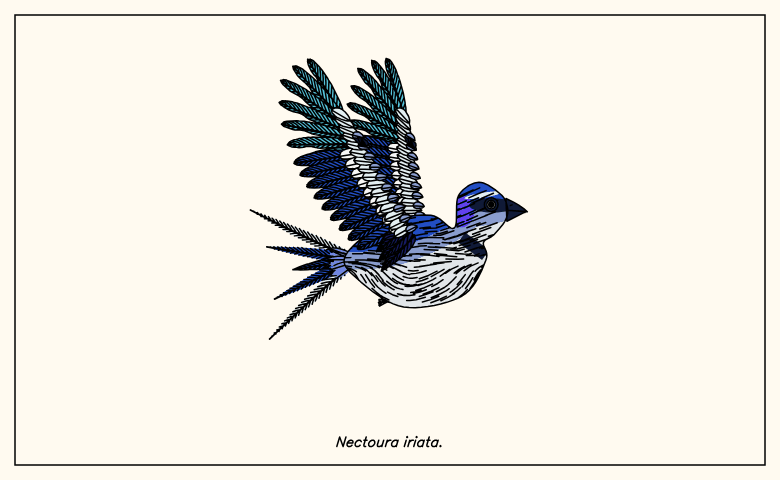

# Put a bird on it

**Procedurally generated bird drawings, drawn feather by feather.**
Perched or in flight, in line art or colour. Animate them and export a GIF.

**[Live demo](https://zevers.github.io/put-a-bird-on-it/)** &nbsp;·&nbsp; no install, runs entirely in your browser



Every bird is generated from a name (the "seed"), so the same name always gives the same bird. Press **New bird** to get a new one, or type nothing and just keep clicking.

## What it does

- **Two poses.** Perched on a branch, or flying with wings spread. Or let it surprise you.
- **Real feathers.** Tail fans, folded and spread wings (primaries, secondaries, tertials, covert rows, alula) and crests are drawn one feather at a time, with asymmetric vanes, curved barbs and split vanes. Overlaps are resolved with hidden-line removal, so it stays clean line art.
- **Body plumage.** Shingled rows of contour feathers that follow the body's flow (small on the head, larger on the breast), or flowing barb strokes, or scallops.
- **Colour, 0 to 10.** 0 is line art. Palettes come from realistic plumage families (sparrow, bluebird and jay, vermilion flycatcher, tropical, goldfinch, raptor and thrush, corvid, kingfisher, dove) with countershading, caps, eye masks, bibs, breast bands, wing bars, white outer tail feathers and belly spots, streaks or bars. 1 colour is a flat silhouette, 2 is back plus underparts, and each step after that adds a role: dark, accent, trim, mid-tone flank, second accent, sheen, second trim, second dark.
- **Animation.** Flying birds flap (the wing folds back mid-stroke). Perched birds bob their head, flick their tail and blink. Export the loop as a **GIF**, save the **SVG**, or **copy the SVG code**.
- **Plotter-friendly.** The output is plain polylines (SVG, JSON, CSV, PostScript), so it can be drawn with a pen plotter.
- **No dependencies.** `birddraw.js` is a single file. The page also uses `gifenc.js`, a small GIF encoder written for this project.

## Run it

Open `index.html` in a browser. That's the whole app.

Or from the command line (Node):

```
node birddraw.js > output.svg
node birddraw.js --seed "Biggus birdus" --pose fly --colors 4 > coloured.svg
node birddraw.js --seed "Biggus birdus" --no-name --no-frame > bare.svg
node birddraw.js --seed "Biggus birdus" --format smil --speed 2 > pen-drawing.svg   # pen-drawing animation (no colour)
```

Options: `--seed "name"`, `--pose perch|fly`, `--colors 0..10`, `--no-name`, `--no-frame`, `--format svg|smil|json|csv|ps`, `--speed n`.

As a library:

```js
const {bird, generate_params, generate_color_plan, bird_frame_job} = require('./birddraw.js');

let polylines = bird(generate_params('fly'));

// with colour: the result array then carries the fills (polylines.fills)
let params = generate_params('perch');
params.color = generate_color_plan(params, 4, 'my seed');

// animation: draw a looping set of frames
let job = bird_frame_job('my seed', 'fly', 4);
for (let i = 0; i < job.n; i++) job.step(i);
let frames = job.finish();
```

## Putting it online

It's a static site, so any static host works. With GitHub Pages: Settings, Pages, deploy from the `main` branch, root folder.

## How it relates to fishdraw

This project began as a variation on [**fishdraw**](https://github.com/LingDong-/fishdraw) by Lingdong Huang, a generator of fish drawings. It started from fishdraw's code and kept its toolbox, then replaced the fish with birds.

**Carried over from fishdraw:** the geometry and polyline-clipping helpers, the noise and shading utilities, the SVG/animation output code, the text rendering and the single-file, plotter-oriented approach.

**New in this project:** the bird generator (anatomy, beaks, eyes, legs, branches), the feather model, folded and spread wings, the flight pose, the contour-feather body plumage, the colour system (palettes, plumage families and placement rules), animation (flapping, head bob, tail flick, blinking), the GIF encoder, and the web interface.

If you like what you see here, go and look at fishdraw too.

## How it was made

Built with [Claude Code](https://claude.com/claude-code), with a human directing the design and reviewing the results.

## License

MIT, see [LICENSE](LICENSE). The licence text and copyright notice from fishdraw are kept, as the MIT licence requires, since this project is derived from it.
